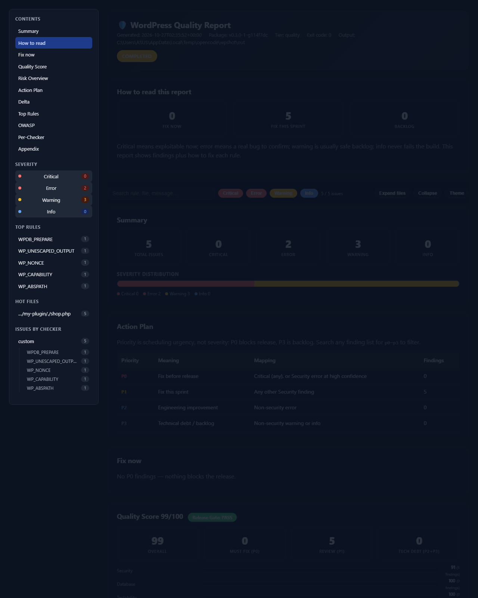

# Rampart WP Checker

[](https://github.com/VietVang-JSC/rampart-wp-checker/releases)
[](LICENSE)
[](composer.json)

One-command quality gate for WordPress plugins and themes. Static analysis,
zero WordPress runtime needed — point it at a plugin folder and get a
security report in seconds.



Free and MIT licensed. No account, no telemetry, no code leaves your machine.

## Install (pick one)

**1. Phar — easiest, no Composer (recommended)**

Requires PHP 8.1+ and nothing else:

```bash
# Download wp-check.phar + wp-check.phar.sha256 from GitHub Releases
php -r "exit(hash_file('sha256','wp-check.phar') === trim(explode(' ',file_get_contents('wp-check.phar.sha256'))[0]) ? 0 : 1);" \
  && echo "checksum OK"
php wp-check.phar --version
```

**2. Composer via GitHub** (until the Packagist submit lands):

```bash
composer config repositories.wp-checker vcs https://github.com/VietVang-JSC/rampart-wp-checker
composer require --dev rampart/wp-quality-checker:^0.3
php vendor/bin/wp-check /path/to/plugin
```

**3. Composer via Packagist** (pending submit): `composer require --dev rampart/wp-quality-checker`.

**4. From source:**

```bash
git clone https://github.com/VietVang-JSC/rampart-wp-checker && cd rampart-wp-checker
composer install --no-interaction
php bin/wp-check /path/to/plugin
```

Details per OS: [`docs/installation.md`](docs/installation.md).

## 60-second quick start

```bash
php wp-check.phar /path/to/my-plugin --min-severity=error --fail-on=none --format=html
# → quality-report.html in ./reports/wp-checker (open in a browser)
```

Expected: a short list of `critical`/`error` findings with file:line and fix
guidance — or a clean bill. The headline count mixes severities; see
[How to read a report](#how-to-read-a-report).

## How to read a report

| Severity | Meaning | What to do |
|---|---|---|
| `critical` | Exploitable now (injection, eval, LFI-shaped include). | Fix before release. |
| `error` | Real bug/security hole, confirm by reading the file. | Fix this sprint. |
| `warning` | Suspicious pattern, often safe (unescaped `echo`, missing nonce). | Backlog. Do not panic. |
| `info` | Convention FYI (prefix, text domain). Never fails the build. | Read if curious. |

A first scan with "50 findings" where 45 are warnings is normal — it is not
50 vulnerabilities.

## WordPress rules (v0.1)

| Rule | Severity | Default | Fires when |
|---|---|---|---|
| `WPDB_PREPARE` | error | on | `$wpdb->query/get_results/get_var/get_row/get_col` with dynamic SQL and no `$wpdb->prepare()` |
| `WP_UNESCAPED_OUTPUT` | warning | on | `echo/print/<?=` without `esc_*()`/`wp_kses()`/cast (WPCS semantics) |
| `WP_NONCE` | warning | on | `admin_post_*`/`wp_ajax_*` handler without nonce verification |
| `WP_CAPABILITY` | error | on | privileged handler without `current_user_can()` (literal `add_*_page` capability counts as checked) |
| `WP_CONFIG_SECRET` | warning | on | empty/placeholder/short secret in `wp-config*.php` (samples skipped) |
| `WP_ABSPATH` | warning | on | plugin entry file without `defined('ABSPATH')` guard |
| `WP_TABLE_PREFIX` | info | off | literal `wp_` table in SQL strings |
| `WP_TEXTDOMAIN` | info | off | translation call without literal domain |

Each rule with true/false examples: [`docs/rules.md`](docs/rules.md).
Generic inherited rules (SQLi, XSS, command injection, SSRF, secrets, eval,
JS/CSS syntax, …) behave like the parent Laravel tool.

## Recipes

```bash
# Quieter review report: errors and criticals only
php wp-check.phar /path/to/plugin --min-severity=error --fail-on=none --format=html

# Hide a noisy rule for now (temporary)
php wp-check.phar /path/to/plugin --min-severity=error --fail-on=none --format=html \
  --ignore=WP_UNESCAPED_OUTPUT

# Legacy plugin: accept current findings, fail only on new ones
php bin/wp-check /path/to/plugin --baseline-generate --fail-on=none
php bin/wp-check /path/to/plugin --baseline-file=baseline.json
```

Fix guidance is on by default. The same scan can produce three HTML files;
the flags below change presentation only, not findings or the gate.

| If the reader will ... | Add this flag | Open or send this file |
|---|---|---|
| Fix the issues | None; this is the default | `quality-report.html` |
| Review the same technical report without fix boxes | `--no-remediation` | `quality-report-findings.html` |
| Read a simplified external summary | `--client` | `quality-report-client.html` |
| Compare or archive every presentation | `--all-variants` | All three files |

Details: [`docs/reports.md`](docs/reports.md). External handoffs:
[`docs/client-reports.md`](docs/client-reports.md).

Machine reports (JSON/SARIF) always carry full data either way.

CI setups (GitHub Actions, GitLab): [`docs/ci.md`](docs/ci.md).

## Options (short)

| Option | Effect |
|---|---|
| `--min-severity=error` | Hide warnings/info from reports (gate still uses `--fail-on`). |
| `--ignore=RULE,...` | Skip whole rules. Dropped from reports, not just the gate. |
| `--fail-on=none` | Review without failing (exit 0). |
| `--exclude-path='*/vendor/*'` | Skip paths (repeatable). `vendor`/`node_modules`/`fixtures` already excluded. |
| `--format=json,html,sarif,md,console,all` | Report formats. SARIF feeds GitHub code scanning. |
| `--no-remediation` | Hide fix guidance in console, HTML, and Markdown reports. Findings, scores, and JSON/SARIF are unchanged. |
| `--client` | Simplified external HTML report. Writes only `quality-report-client.html`, with relative paths and no editor links. |
| `--all-variants` | With HTML, write the full, findings-only, and client presentations in one run. |
| `--version` | Print tool version. |

Exit codes: `0` clean/review · `1` gate failed · `2` bad invocation · `3` internal error.

## Honest limits (v0.1)

- Heuristics, not proof. No precision claims yet — the 100-case corpus lands in v0.2.
- `call_user_func($dynamic)` flags behind `is_callable` guards; `include` with `basename()` still flags; unknown function params are clean.
- Standalone only. Scans code, never boots WordPress.

Troubleshooting & FAQ: [`docs/faq.md`](docs/faq.md).

## Releases

- GitHub Releases carry `wp-check.phar` + `.sha256` per tag.
- Packagist (`rampart/wp-quality-checker`): pending submit — Composer path unlocks then.

## License

MIT.
