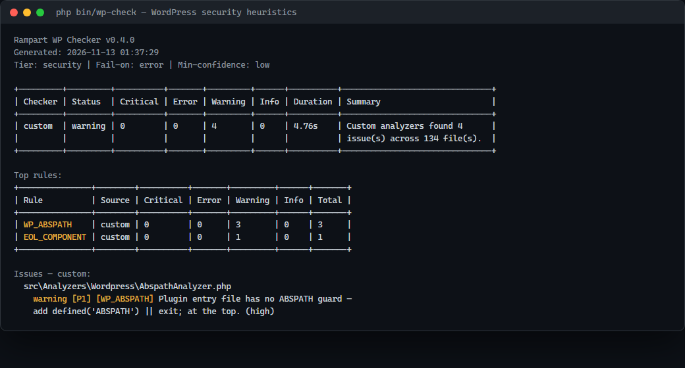

---
layout: default
title: Rampart WP Checker — 日本語
description: WordPress 向け品質ゲートの日本語ドキュメント。
---

# Rampart WP Checker — 日本語




[English]({{ site.baseurl }}/en/) · [日本語]({{ site.baseurl }}/ja/) · [Tiếng Việt]({{ site.baseurl }}/vi/)

**WordPress プラグイン/テーマ**向けの品質ゲート。PHP 8.1+ で動作し、WordPress
を起動せずに静的解析のみ行います。アカウント不要、テレメトリなし。

## Rampart ファミリー

| プロジェクト | 対象 | リポジトリ | ドキュメント |
|---|---|---|---|
| **Rampart** | Laravel Artisan 品質ゲート | [GitHub](https://github.com/thiennhant95/Rampart) | [Pages](https://thiennhant95.github.io/Rampart/) |
| **Rampart PHP** | プレーン PHP + 各フレームワーク、PHP 7.4+ | [GitHub](https://github.com/thiennhant95/Rampart-PHP) | [Pages](https://thiennhant95.github.io/Rampart-PHP/) |
| **Rampart WP** | WordPress プラグイン/テーマ | [GitHub](https://github.com/thiennhant95/Rampart-Wordpress) | [Pages](https://thiennhant95.github.io/Rampart-Wordpress/) |

## インストール

**ソースから（現在利用可能）:**

```bash
git clone https://github.com/thiennhant95/Rampart-Wordpress.git
cd Rampart-Wordpress
composer install --no-interaction
php bin/wp-check /path/to/plugin
```

**Phar:** GitHub Releases から `wp-check.phar` と `.sha256` を取得し、チェックサム
を検証して `php wp-check.phar --version` を実行します。

**Composer（GitHub 経由）:**

```bash
composer config repositories.wp-checker vcs https://github.com/thiennhant95/Rampart-Wordpress
composer require --dev rampart/wp-quality-checker:^0.4
php vendor/bin/wp-check /path/to/plugin
```

ツールの実行には PHP 8.1+ が必要です。スキャン対象は WordPress が対応する
任意の PHP バージョンで構いません。

## クイックスタート

```bash
php bin/wp-check /path/to/my-plugin --min-severity=error --fail-on=none --format=html
```

レポートは `reports/wp-checker/` に出力されます。終了コード: `0` 合格/レビュー ·
`1` ゲート失敗 · `2` 不正な引数 · `3` 内部エラー。

## 検査内容

ラップするツール: WPCS（`phpcs`）、`phpstan`、`phpunit`。

| ルール | 重大度 | 検出条件 |
|---|---|---|
| `WPDB_PREPARE` | error | `$wpdb` のクエリに動的 SQL かつ `prepare()` なし |
| `WP_UNESCAPED_OUTPUT` | warning | `esc_*()`/`wp_kses()`/キャストなしの出力 |
| `WP_NONCE` | warning | `admin_post_*`/`wp_ajax_*` で nonce 検証なし |
| `WP_CAPABILITY` | error | 特権ハンドラで `current_user_can()` なし |
| `WP_CONFIG_SECRET` | warning | `wp-config*.php` の空/プレースホルダー/短い秘密情報 |
| `WP_ABSPATH` | warning | プラグイン入口で `defined('ABSPATH')` なし |
| `WP_TABLE_PREFIX` | info（任意） | SQL 内のリテラル `wp_` テーブル |
| `WP_TEXTDOMAIN` | info（任意） | リテラルでない翻訳ドメイン |

汎用ルール（SQLi、XSS、コマンドインジェクション、SSRF、秘密情報、eval、
JS/CSS 構文など）は親 Rampart と同じ動作です。例: [rules.html]({{ site.baseurl }}/rules.html)

## レポート

`console` / `json` / `html` / `md` / `sarif`。HTML は開発者向け、
`--no-remediation`（修正ガイドなし）、`--client`（外部向け）、
`--all-variants`（3 種類）に対応。詳細: [reports.html]({{ site.baseurl }}/reports.html)

## CI

```yaml
- run: composer install --prefer-dist --no-progress
- run: php bin/wp-check . --min-severity=error --fail-on=error --format=json
```

GitHub コードスキャンには `--format=sarif` を追加して SARIF をアップロードします。
レシピ: [ci.html]({{ site.baseurl }}/ci.html)

## ベースライン

```bash
php bin/wp-check /path/to/plugin --baseline-generate --fail-on=none
php bin/wp-check /path/to/plugin --baseline-file=baseline.json
```

インライン抑制: `// rampart-ignore RULE_ID` または
`// rampart-ignore-next-line RULE_ID`。

## 制限

- ヒューリスティックであり証明ではありません。修正前に file:line を確認してください。
- `is_callable` ガード付きの `call_user_func($dynamic)` は依然として検出される場合があります。
- スタンドアロンのみ。WordPress を起動せずコードをスキャンします。

FAQ: [faq.html]({{ site.baseurl }}/faq.html) · インストール: [installation.html]({{ site.baseurl }}/installation.html)

## ライセンス

MIT © 2026 Rampart.
