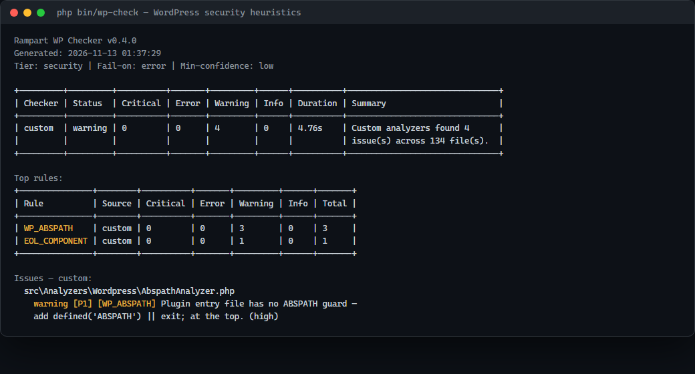

---
layout: default
title: Rampart WP Checker — Tiếng Việt
description: Tài liệu tiếng Việt cho quality gate WordPress.
---

# Rampart WP Checker — Tiếng Việt




[English]({{ site.baseurl }}/en/) · [日本語]({{ site.baseurl }}/ja/) · [Tiếng Việt]({{ site.baseurl }}/vi/)

Quality gate cho **plugin và theme WordPress** trên **PHP 8.1+**. Phân tích tĩnh,
không cần WordPress runtime, không tài khoản, không telemetry. Tool quét code,
không boot WordPress.

## Hệ sinh thái Rampart

| Dự án | Phạm vi | Repository | Tài liệu |
|---|---|---|---|
| **Rampart** | Quality gate Laravel (Artisan) | [GitHub](https://github.com/thiennhant95/Rampart) | [Pages](https://thiennhant95.github.io/Rampart/) |
| **Rampart PHP** | PHP thuần + đa framework, PHP 7.4+ | [GitHub](https://github.com/thiennhant95/Rampart-PHP) | [Pages](https://thiennhant95.github.io/Rampart-PHP/) |
| **Rampart WP** | Plugin/theme WordPress | [GitHub](https://github.com/thiennhant95/Rampart-Wordpress) | [Pages](https://thiennhant95.github.io/Rampart-Wordpress/) |

## Cài đặt

**Từ source (dùng được ngay):**

```bash
git clone https://github.com/thiennhant95/Rampart-Wordpress.git
cd Rampart-Wordpress
composer install --no-interaction
php bin/wp-check /path/to/plugin
```

**Phar:** tải `wp-check.phar` + `.sha256` từ GitHub Releases, kiểm tra checksum,
rồi chạy `php wp-check.phar --version`.

**Composer qua GitHub:**

```bash
composer config repositories.wp-checker vcs https://github.com/thiennhant95/Rampart-Wordpress
composer require --dev rampart/wp-quality-checker:^0.4
php vendor/bin/wp-check /path/to/plugin
```

Yêu cầu PHP 8.1+ để chạy tool. Plugin được quét có thể dùng bất kỳ PHP version
nào WordPress hỗ trợ.

## Chạy nhanh

```bash
php bin/wp-check /path/to/my-plugin --min-severity=error --fail-on=none --format=html
```

Báo cáo ghi vào `reports/wp-checker/`. Exit code: `0` sạch/review · `1` fail gate ·
`2` sai tham số · `3` lỗi nội bộ.

## Kiểm tra gì

Tool wrap: WPCS (`phpcs`), `phpstan`, `phpunit`.

| Rule | Severity | Khi nào báo |
|---|---|---|
| `WPDB_PREPARE` | error | `$wpdb` query động mà không `prepare()` |
| `WP_UNESCAPED_OUTPUT` | warning | `echo/print/<?=` thiếu `esc_*()`/`wp_kses()`/cast |
| `WP_NONCE` | warning | `admin_post_*`/`wp_ajax_*` không verify nonce |
| `WP_CAPABILITY` | error | handler đặc quyền thiếu `current_user_can()` |
| `WP_CONFIG_SECRET` | warning | secret rỗng/placeholder/ngắn trong `wp-config*.php` |
| `WP_ABSPATH` | warning | file entry thiếu `defined('ABSPATH')` |
| `WP_TABLE_PREFIX` | info (opt-in) | bảng `wp_` literal trong SQL |
| `WP_TEXTDOMAIN` | info (opt-in) | translation thiếu domain literal |

Các rule generic (SQLi, XSS, command injection, SSRF, secret, eval, JS/CSS...)
hoạt động như Rampart cha. Ví dụ đầy đủ: [rules.html]({{ site.baseurl }}/rules.html)

## Báo cáo

`console`, `json`, `html`, `md`, `sarif`. HTML có biến thể developer,
findings-only (`--no-remediation`), client (`--client`), hoặc cả 3
(`--all-variants`). Chi tiết: [reports.html]({{ site.baseurl }}/reports.html)

## CI

```yaml
- run: composer install --prefer-dist --no-progress
- run: php bin/wp-check . --min-severity=error --fail-on=error --format=json
```

Thêm `--format=sarif` và upload file SARIF để dùng GitHub code scanning.
Công thức: [ci.html]({{ site.baseurl }}/ci.html)

## Baseline

```bash
php bin/wp-check /path/to/plugin --baseline-generate --fail-on=none
php bin/wp-check /path/to/plugin --baseline-file=baseline.json
```

Suppression inline: `// rampart-ignore RULE_ID` hoặc
`// rampart-ignore-next-line RULE_ID`.

## Giới hạn

- Đây là heuristic, không phải chứng minh. Đọc file:line trước khi sửa/suppress.
- `call_user_func($dynamic)` có guard `is_callable` vẫn có thể bị báo.
- Chỉ standalone: tool quét code, không boot WordPress.

FAQ: [faq.html]({{ site.baseurl }}/faq.html) · Cài đặt: [installation.html]({{ site.baseurl }}/installation.html)

## Giấy phép

MIT © 2026 Rampart.
